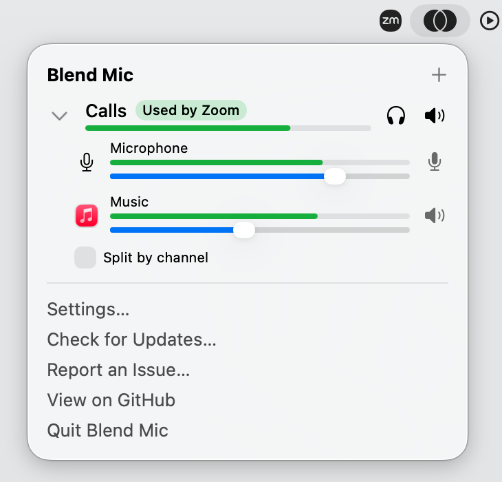

# Blend Mic

Build your own mic. Blend Mic mixes your voice with any app or everything your Mac plays into one microphone, with a slider for each.

<picture>
  <source srcset="docs/images/panel-dark.png" media="(prefers-color-scheme: dark)">
  
</picture>

Each mix shows up as a microphone, so any app that lets you pick one can use it: Discord, Zoom, a call recorder, OBS, a website.

## Why

I wanted something simple to hook into Discord and my call recorder. BlackHole needed a lot of setup before anything worked, and Loopback costs $99, so I made one that sits in the menu bar.

## Install

Download the DMG from the [latest release](https://github.com/spashii/blend/releases/latest), open it, and drag the app to Applications. Or use Homebrew:

```sh
brew tap spashii/blend https://github.com/spashii/blend
brew trust spashii/blend
brew install --cask blend
```

Blend Mic opens to its Setup page. It installs the audio driver that makes mixes appear as microphones (one administrator password), asks for the microphone and for audio from other apps, and offers to open at login. Mixes are silent while Blend Mic is closed, so leave that on. After that it updates itself, installing new versions while no app is using a mix.

## Requirements

Apple silicon and macOS 15 or later. Apple silicon because that's all it has been tested on. macOS 15 for the first-launch window and High Quality voice isolation; app audio capture itself needs 14.2.

## Some notes

Blend Mic is about a week old. Expect bugs.

Report them at [github.com/spashii/blend/issues](https://github.com/spashii/blend/issues).

## Privacy

Your audio never leaves your Mac, and there are no accounts. Blend Mic checks for updates once a day, and the update server counts those checks by app, version and country and never stores your IP address.

## Documentation

- [Record online calls](./docs/user/record-calls-with-headphones.md)
- [Play music into an online call](./docs/user/music-into-a-call.md)
- [Echo cancellation and voice isolation](./docs/user/echo-cancellation-and-voice-isolation.md)
- [Check a mix](./docs/user/check-a-mix.md)
- [Troubleshooting](./docs/user/troubleshooting.md)
- [Tested with](./docs/user/tested-with.md)
- [Updates](./docs/user/updates.md)
- [Uninstall](./docs/user/uninstall.md)

Building from source? Start at [docs/operations/development.md](./docs/operations/development.md). How it works is in [docs/internals/overview.md](./docs/internals/overview.md).

## License

MIT, see [LICENSE](LICENSE). Blend Mic includes [libASPL](https://github.com/gavv/libASPL), [JSON for Modern C++](https://github.com/nlohmann/json), and [WebRTC audio processing](https://gitlab.freedesktop.org/pulseaudio/webrtc-audio-processing) with [Abseil](https://github.com/abseil/abseil-cpp). Their licenses are in [THIRD_PARTY_NOTICES.md](THIRD_PARTY_NOTICES.md).

Blend Mic learned from [BlackHole](https://github.com/ExistentialAudio/BlackHole), [Background Music](https://github.com/kyleneideck/BackgroundMusic), [roc-vad](https://github.com/roc-streaming/roc-vad) and [AudioCap](https://github.com/insidegui/AudioCap).
